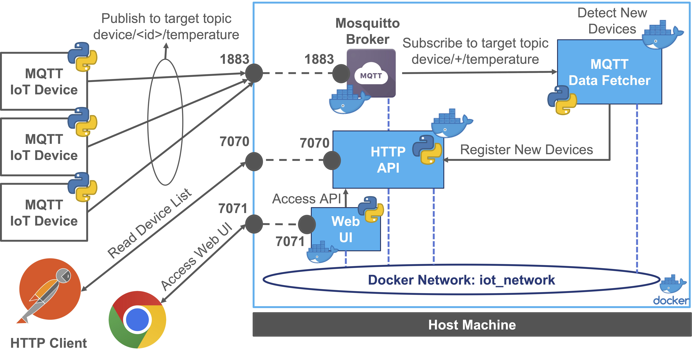
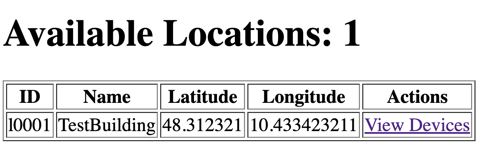
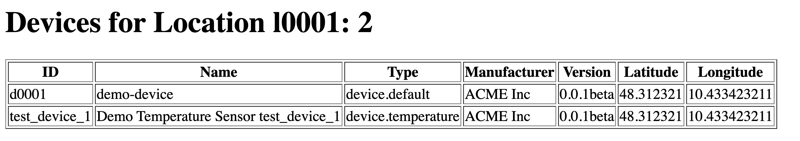

# Microservices IoT Application with Docker - Playground

In this playground, we are going to build and deploy a simple IoT application using Docker containers.
The main concept is to create a simple IoT Inventory system with a RESTful HTTP API to manage locations and devices
integrated with an MQTT Broker to receive telemetry data from IoT devices and register them in the inventory.
Furthermore, we are going to build a simple Web Interface to interact with the inventory system and display the locations and devices.



The main components of the system are:

- **MQTT Broker**: The MQTT broker is used to receive telemetry data from IoT devices and publish them to the subscribers.
- **IoT Inventory**: The HTTP API is used to manage locations and devices in the inventory.
- **MQTT Data Fetcher**: MQTT to HTTP Inventory Integration: The MQTT Data Fetcher is used to subscribe to an MQTT topic and process incoming messages to interact with the Inventory API.
- **Web UI**: The Web Interface is used to interact with the inventory system and display the locations and devices.

The outline of the playground is the following:

- [Project Structure](#project-structure)
- [Python Services with uv](#python-services-with-uv)
- [Docker Images with uv](#docker-images-with-uv)
- [Create a Docker Network](#create-a-docker-network)
- [MQTT Broker - Eclipse Mosquitto](#mqtt-broker---eclipse-mosquitto)
- [Python - IoT Inventory - RESTful HTTP API](#python---iot-inventory---restful-http-api)
- [MQTT Data Fetcher - MQTT to HTTP Inventory Integration](#mqtt-data-fetcher---mqtt-to-http-inventory-integration)
- [Web UI - IoT Inventory Web Interface](#web-ui---iot-inventory-web-interface)
- [MQTT Temperature Sensor Example](#mqtt-temperature-sensor-example)
- [Run & Test the System](#run--test-the-system)
- [Docker Compose](#docker-compose)

## Project Structure

Each microservice is an **independent Python project** with its own dependencies, configuration and Dockerfile:
it can be developed, tested, built and deployed without the others, which is one of the key properties of a
microservices architecture.

```
iot-microservice-arch-playground/
├── mqtt-broker/            # Configuration of the Eclipse Mosquitto broker
├── http-api/               # IoT Inventory RESTful HTTP API (Flask + Flask-RESTful)
│   ├── pyproject.toml      # Dependencies and commands of the service
│   ├── uv.lock             # Locked dependency versions
│   ├── Dockerfile          # Docker image of the service (built with uv)
│   ├── conf.yaml           # Default configuration (local development)
│   ├── postman/            # Postman collection to test the API
│   └── src/iot_inventory_api/
│       ├── api_server.py   # Entry point of the service
│       ├── model/ dto/ resources/ persistence/ config/
│       └── client/         # Example HTTP clients of the API
├── data-fetcher/           # MQTT Data Fetcher (Paho MQTT 2.x + requests)
│   ├── fetcher_conf.yaml           # Default configuration (local development)
│   ├── target_fetcher_conf.yaml    # Configuration for the Docker deployment
│   └── src/mqtt_data_fetcher/
├── web-ui/                 # Web Interface (Flask + requests)
│   ├── web_conf.yaml               # Default configuration (local development)
│   ├── target_web_conf.yaml        # Configuration for the Docker deployment
│   └── src/iot_inventory_web_ui/   # Web Server and HTML templates
├── mqtt-tester/            # Emulated IoT devices (not deployed with Docker)
└── docker-compose/         # Docker Compose file and the configuration files of the deployment
```

## Python Services with uv

Every Python project (`http-api`, `data-fetcher`, `web-ui` and `mqtt-tester`) is managed with [uv](https://docs.astral.sh/uv/):
dependencies are declared in its `pyproject.toml`, locked in its `uv.lock`, and the Python version (3.12) is pinned in
its `.python-version`. Install uv (if needed) following the [official instructions](https://docs.astral.sh/uv/getting-started/installation/), e.g.:

```bash
curl -LsSf https://astral.sh/uv/install.sh | sh
```

To run a service locally (e.g., during development), move to its folder, install the dependencies and run its command:

```bash
cd http-api
uv sync
uv run iot-inventory-api
```

| Project        | Command(s)                                                                                                     | Configuration       |
|----------------|----------------------------------------------------------------------------------------------------------------|---------------------|
| `http-api`     | `iot-inventory-api`, example clients: `get-location-list`, `get-location`, `create-location`, `create-and-get-location`, `update-location`, `delete-location` | `conf.yaml`         |
| `data-fetcher` | `mqtt-data-fetcher`                                                                                            | `fetcher_conf.yaml` |
| `web-ui`       | `iot-inventory-web-ui`                                                                                         | `web_conf.yaml`     |
| `mqtt-tester`  | `mqtt-device-producer [device_id]`, `mqtt-telemetry-consumer`                                                  | `tester_conf.yaml`  |

Each service reads its configuration file from the current working directory or, if not found, from the root folder of
the service. Locally the default files point to `127.0.0.1`, while in the containers the files are replaced with the
`target_*` versions (see the following sections).

The `requirements.txt` file of each project is **generated** from `uv.lock` and is kept only for pip-based workflows
(`pip install -r requirements.txt`). After changing the dependencies, regenerate it with
`uv export --no-hashes --no-dev -o requirements.txt`.

## Docker Images with uv

All the services use the same structure of Dockerfile, based on the official `python:3.12-slim` image and on uv.
For example, the Dockerfile of the `http-api` service is:

```dockerfile
# Base image with Python 3.12 (Debian slim)
FROM python:3.12-slim

# Copy the uv binary from the official uv image (pinned version for reproducible builds)
COPY --from=ghcr.io/astral-sh/uv:0.13.0 /uv /uvx /bin/

# Set the target container working directory to /app
WORKDIR /app

# uv settings: compile the bytecode at install time, use the Python of the image (no downloads)
# and print the application output without buffering
ENV UV_COMPILE_BYTECODE=1 \
    UV_PYTHON_DOWNLOADS=never \
    PYTHONUNBUFFERED=1

# 1. Install only the dependencies, using the locked versions of uv.lock.
#    This layer is rebuilt only when pyproject.toml or uv.lock change, not when the source code changes
COPY pyproject.toml uv.lock .python-version ./
RUN uv sync --frozen --no-dev --no-install-project

# 2. Copy the source code and the default configuration, then install the project itself
COPY src ./src
COPY conf.yaml ./conf.yaml
RUN uv sync --frozen --no-dev

# Use the virtual environment created by uv
ENV PATH="/app/.venv/bin:$PATH"

# Exposed Port of the API Server
EXPOSE 7070

# Run the target application (command declared in pyproject.toml)
CMD ["iot-inventory-api"]
```

The main elements are:

- `COPY --from=ghcr.io/astral-sh/uv:0.13.0 /uv /uvx /bin/` copies the uv executable from its official image
  (a **multi-stage copy**): no installation script is needed and the version is pinned;
- the installation is split in **two steps** to exploit the **layer cache** of Docker. The first `uv sync` installs
  only the dependencies (`--no-install-project`) from `pyproject.toml` and `uv.lock`: this layer is rebuilt only when
  the dependencies change. The source code is copied afterwards, so changing the code only rebuilds the last layers;
- `--frozen` installs exactly the versions of `uv.lock` (the build fails if the lock file is not up to date), and
  `--no-dev` skips the development dependencies: the container runs the same versions used during the development;
- the virtual environment `/app/.venv` is added to the `PATH`, so the `CMD` runs the command of the service declared
  in `pyproject.toml` (e.g., `iot-inventory-api`);
- the `.dockerignore` file excludes the local `.venv` and the caches from the build context.

The service is the main process of the container (PID 1) and handles the `SIGTERM` signal sent by `docker stop`,
so the container stops immediately instead of waiting for the timeout of Docker.

## Create a Docker Network

Since we are going to deploy multiple containers, we need to create a dedicated network to allow communication between them.
**In this way containers can communicate with each other using the container name as the hostname.**
This approach will simplify the configuration and the deployment of the services instead of using the IP address of the host machine.

Create a Docker network to allow the containers to communicate with each other:

```bash
docker network create iot_network
```

Listing the networks:

```bash
docker network ls
```

All the containers that we are going to build and deploy will be connected to this network to allow communication between them.
In order to connect a container to a network, you can use the following parameter `--network iot_network` at the run time:

```bash
docker run --name=<container_name> --network iot_network <other_options> <image_name>
```

## MQTT Broker - Eclipse Mosquitto

This section provides a guide for setting up and customizing an MQTT broker using Eclipse Mosquitto.
We use the official eclipse-mosquitto Docker image on Docker Hub ([Link](https://hub.docker.com/_/eclipse-mosquitto)),
and the version for this example is `2.0.22`.

We "customize" our MQTT broker at runtime with the following configurations:

- Local `mosquitto.conf` file: `-v <LOCAL_PATH>/mosquitto.conf:/mosquitto/config/mosquitto.conf`
- Local `data` folder for persistence: `-v <LOCAL_PATH>/data:/mosquitto/data`
- Local `log` folder for easy access: `-v <LOCAL_PATH>/log:/mosquitto/log`
- Port mapping: `-p 1883:1883`
- Restart always: `--restart always`
- Daemon mode: `-d`

Move to the broker folder

```bash
cd mqtt-broker
```

Run the container (on Linux and macOS, and in Windows PowerShell, `${PWD}` is the current folder):

```bash
docker run --name=my-mosquitto-broker --network iot_network -p 1883:1883 -v ${PWD}/mosquitto.conf:/mosquitto/config/mosquitto.conf -v ${PWD}/data:/mosquitto/data -v ${PWD}/log:/mosquitto/log --restart always -d eclipse-mosquitto:2.0.22
```

At the end of the test, you can stop and remove the container using the following commands:

```bash
docker stop my-mosquitto-broker
docker rm my-mosquitto-broker
```

## Python - IoT Inventory - RESTful HTTP API

In this example we have a demo implementation of a simple IoT device and location inventory through an HTTP RESTful API.
It utilizes Flask and Flask RESTful and provides a simple API to manage locations and devices that is going to be
used by the other components of the system such as the MQTT Data Fetcher and the Web Interface together with
external clients through HTTP requests.

The API is available with the prefix `/api/v1/iot/inventory` and exposes the following resources:

| Resource                                         | Methods          | Description                                       |
|--------------------------------------------------|------------------|---------------------------------------------------|
| `/location`                                      | GET, POST        | List the locations, create a new location         |
| `/location/<location_id>`                        | GET, PUT, DELETE | Read, update and delete a location                |
| `/location/<location_id>/device`                 | GET, POST        | List the devices (optional `?type=` filter), create a device |
| `/location/<location_id>/device/<device_id>`     | GET, PUT, DELETE | Read, update and delete a device                  |

At startup the inventory contains the demo location `l0001` with the demo device `d0001`.

Move to the project folder:

```bash
cd http-api
```

Build the container image:

```bash
docker build -t http_iot_inventory_api:0.1 .
```

Run the container:

```bash
docker run --name=http-inventory-api --network iot_network -p 7070:7070 --restart always -d http_iot_inventory_api:0.1
```

The image contains the default configuration file (`/app/conf.yaml`). If necessary we can also run the container with
a different configuration, mounting a local file over the default one:

```bash
docker run --name=http-inventory-api --network iot_network -p 7070:7070 -v ${PWD}/conf.yaml:/app/conf.yaml --restart always -d http_iot_inventory_api:0.1
```

The `client` package contains example clients of the API (`uv run get-location-list`, `uv run create-and-get-location`, ...)
and the `postman` folder contains a Postman collection with the main requests.

At the end of the test, you can stop and remove the container using the following commands:

```bash
docker stop http-inventory-api
docker rm http-inventory-api
```

## MQTT Data Fetcher - MQTT to HTTP Inventory Integration

This second Python application implements the integration between an MQTT client and an HTTP Inventory API using the Paho MQTT library (2.x).
The main goal is to subscribe to an MQTT topic and process incoming messages to interact with the Inventory API.
Main implemented features are:

- MQTT Subscription to the topic `device/+/temperature`, renewed at each automatic reconnection
- Message Processing with HTTP requests to the Inventory API:
  - GET Request to check the existence of the device (`<device_api_url>/<device_id>`)
  - POST Request to create the device if it does not exist (`<device_api_url>`)
- Automatic retry of the connection if the broker is not available yet (e.g., when its container is still starting)

In order to build the container, move to the target folder

```bash
cd data-fetcher
```

Build the container image:

```bash
docker build -t mqtt_data_fetcher:0.1 .
```

In this case we cannot run the container with the default configuration, because the container needs to know where the
MQTT broker and the HTTP Inventory API are, so we need to pass a configuration file at runtime.

The configuration file that we can use is named `target_fetcher_conf.yaml` and contains the following parameters:

```yaml
# MQTT Data Fetcher configuration (Docker deployment: the other services are reached through their container names)
broker_ip: "my-mosquitto-broker"
broker_port: 1883
client_id: "mqtt-data-fetcher"
username: null
password: null
target_telemetry_topic: "device/+/temperature"
device_api_url: "http://http-inventory-api:7070/api/v1/iot/inventory/location/l0001/device"
```

>**Note:** During the development of the application we are not in the docker environment,
> so we can use the local configuration file (`fetcher_conf.yaml`) to test the application with `uv run mqtt-data-fetcher`.
>Only at the deployment time, we need to pass the target configuration file to the container.

In this case we use `http://http-inventory-api:7070/api/v1/iot/inventory/location/l0001/device` instead for
example of `http://192.168.1.123:7070/api/v1/iot/inventory/location/l0001/device` since it is more flexible and
we can use the container name as the hostname to refer to the other containers in the same network.

Furthermore, we cannot use `http://127.0.0.1:7070/api/v1/iot/inventory/location/l0001/device` because inside a container
the `loopback` address refers to the container itself and not to the host machine or to the other containers.

At the run time we pass the configuration file to the container using `-v`, mounting the local
file with the configuration (`target_fetcher_conf.yaml`) over the container file (`/app/fetcher_conf.yaml`):

```bash
docker run --name=mqtt-data-fetcher --network iot_network -v ${PWD}/target_fetcher_conf.yaml:/app/fetcher_conf.yaml --restart always -d mqtt_data_fetcher:0.1
```

At the end of the test, you can stop and remove the container using the following commands:

```bash
docker stop mqtt-data-fetcher
docker rm mqtt-data-fetcher
```

## Web UI - IoT Inventory Web Interface

This component provides the user interface for the system, allowing users to interact with the
application through a web browser. It displays location and device information through dedicated pages and tables.

The implementation is based on Flask ([https://flask.palletsprojects.com/](https://flask.palletsprojects.com/)) and on
the Jinja2 templates of the `templates` folder.

The web interface does not store any data: it interacts with the IoT Inventory API to retrieve the information to display,
through HTTP requests to the API endpoints. If the API is not available, the pages answer with `503 Service Unavailable`.

In order to build the container, move to the target folder

```bash
cd web-ui
```

Build the container image:

```bash
docker build -t web-ui:0.1 .
```

Run the target container with the configuration file `target_web_conf.yaml`, that contains the configuration for the web interface
and overwrites the default configuration of the container:

```yaml
# Web UI configuration (Docker deployment: the API is reached through its container name)
web:
  host: "0.0.0.0"
  port: 7071
  api_base_url: "http://http-inventory-api:7070/api/v1/iot/inventory"
```

This configuration file is used to set the base URL of the API.
**In this case since we have a dedicated network for the containers, we can use the container name as the hostname.**
Otherwise, you can use the IP address of the host machine and change the configuration file accordingly at every deployment and/or
change of the host machine IP address.

>**Note:** During the development of the application we are not in the docker environment,
> so we can use the local configuration file (`web_conf.yaml`) to test the application with `uv run iot-inventory-web-ui`.
>Only at the deployment time, we need to pass the target configuration file to the container.

At the run time we pass the configuration file to the container using `-v`, mounting the local
file with the configuration (`target_web_conf.yaml`) over the container file (`/app/web_conf.yaml`):

```bash
docker run --name=web-ui --network iot_network -p 7071:7071 -v ${PWD}/target_web_conf.yaml:/app/web_conf.yaml --restart always -d web-ui:0.1
```

At the end of the test, you can stop and remove the container using the following commands:

```bash
docker stop web-ui
docker rm web-ui
```

## MQTT Temperature Sensor Example

In order to test the system, we can use the `mqtt-tester` project, that simulates temperature sensors publishing
data to the MQTT broker with the Paho MQTT library (2.x).

The broker is configured in `mqtt-tester/tester_conf.yaml` (default: `127.0.0.1:1883`, i.e., the port published by the broker container):

```yaml
# MQTT Broker used by the testers (the broker container publishes the port 1883 on the host)
broker_ip: "127.0.0.1"
broker_port: 1883
# Optional credentials (null if the broker does not require authentication)
username: null
password: null
```

Run an emulated device passing its id as argument (default: `test_device_1`):

```bash
cd mqtt-tester
uv sync
uv run mqtt-device-producer test_device_1
```

The script waits for the connection to the broker (`on_connect` callback) and then publishes a simulated temperature
measurement every 5 seconds on the topic `device/<device_id>/temperature`, in JSON format:

```json
{"timestamp": 1731877690, "data_type": "TEMPERATURE_SENSOR", "value": 24.527828679520105}
```

Run more producers with different ids to emulate more devices. The `uv run mqtt-telemetry-consumer` command prints
all the telemetry flowing through the broker.

## Run & Test the System

After running all the containers, you can test the system by interacting with the Web Interface or by using the MQTT Temperature Sensor Example.
For example, you can use Postman or a browser to access the API using the following URL [http://127.0.0.1:7070/api/v1/iot/inventory/location](http://127.0.0.1:7070/api/v1/iot/inventory/location)

The result will be something like:

```json
[
  {
    "uuid": "l0001",
    "name": "TestBuilding",
    "latitude": 48.312321,
    "longitude": 10.433423211,
    "device_list": [
      "d0001"
    ]
  }
]
```

We can also check the list of devices in the location (`l0001`) with the following URL [http://127.0.0.1:7070/api/v1/iot/inventory/location/l0001/device](http://127.0.0.1:7070/api/v1/iot/inventory/location/l0001/device)
The result will be something like:

```json
[
  {
    "uuid": "d0001",
    "name": "demo-device",
    "locationId": "l0001",
    "type": "device.default",
    "manufacturer": "ACME Inc",
    "software_version": "0.0.1beta",
    "latitude": 48.312321,
    "longitude": 10.433423211
  },
  {
    "uuid": "test_device_1",
    "name": "Demo Temperature Sensor test_device_1",
    "locationId": "l0001",
    "type": "device.temperature",
    "manufacturer": "ACME Inc",
    "software_version": "0.0.1beta",
    "latitude": 48.312321,
    "longitude": 10.433423211
  }
]
```

This response contains a default registered device `d0001` and the device that we are simulating with the MQTT Temperature Sensor Example
with the id `test_device_1`, registered by the MQTT Data Fetcher when it received its first message.

Open the Web Interface using the following HTTP URL [http://127.0.0.1:7071/locations](http://127.0.0.1:7071/locations)
it will display the list of locations and devices in a table format.



And click on the `View Devices` action it is possible to see the list of devices in the location with the associated details
available at the HTTP URL endpoint [http://127.0.0.1:7071/location/l0001/devices](http://127.0.0.1:7071/location/l0001/devices)



## Docker Compose

In order to simplify the deployment and the management of the containers,
we can use a Docker Compose file to define and run multi-container Docker applications.

The Docker Compose file is a YAML file that describes the services of the application (image, ports, volumes,
networks and dependencies) and allows to manage all of them with a single command.

>**Note1:** Run the `docker compose` commands from the folder of the Docker Compose file (`docker-compose`).

>**Note2:** The Docker Compose file should be named `docker-compose.yml` or `docker-compose.yaml`
> (`compose.yaml` is also supported).

>**Note3:** The relative paths of the volumes (e.g., `./mosquitto.conf`) are resolved with respect to the folder of
> the Docker Compose file, so the same file works on Linux, macOS and Windows.

The complete Docker Compose file for the deployment of the system with its 4 containers and the dedicated network is the following:

```yaml
# IoT Microservices Application: MQTT Broker, IoT Inventory API, Web UI and MQTT Data Fetcher.
# From this folder run: docker compose up --build
# The relative paths are resolved with respect to the folder of this file.

services:

  my-mosquitto-broker:
    container_name: my-mosquitto-broker
    image: eclipse-mosquitto:2.0.22
    ports:
      - "1883:1883"
    volumes:
      - ./mosquitto.conf:/mosquitto/config/mosquitto.conf
      - ./data:/mosquitto/data
      - ./log:/mosquitto/log
    restart: always
    networks:
      - iot_network

  http-inventory-api:
    container_name: http-inventory-api
    # Image built from the Dockerfile of the http-api folder (or already built with docker build)
    build: ../http-api
    image: http_iot_inventory_api:0.1
    ports:
      - "7070:7070"
    volumes:
      - ./target_api_conf.yaml:/app/conf.yaml
    restart: always
    networks:
      - iot_network

  web-ui:
    container_name: web-ui
    build: ../web-ui
    image: web-ui:0.1
    ports:
      - "7071:7071"
    volumes:
      - ./target_web_conf.yaml:/app/web_conf.yaml
    restart: always
    depends_on:
      - http-inventory-api
    networks:
      - iot_network

  mqtt-data-fetcher:
    container_name: mqtt-data-fetcher
    build: ../data-fetcher
    image: mqtt_data_fetcher:0.1
    volumes:
      - ./target_fetcher_conf.yaml:/app/fetcher_conf.yaml
    restart: always
    depends_on:
      - my-mosquitto-broker
      - http-inventory-api
    networks:
      - iot_network

networks:
  iot_network:
    driver: bridge
```

Each Python service has both a `build` and an `image` entry: Docker Compose can build the images directly from the
folders of the services (tagging them with the name of `image`), or use the images already built with `docker build`.
The configuration files of the deployment (`target_api_conf.yaml`, `target_web_conf.yaml` and `target_fetcher_conf.yaml`)
are in the same folder of the Docker Compose file and are mounted over the default configuration of each image.

In order to run the application with the Docker Compose file, move to the folder where the file is located:

```bash
cd docker-compose
```

Build the images (if needed) and run the application described in the compose file:

```bash
docker compose up --build
```

You can also run the application as a daemon in background

```bash
docker compose up -d
```

You can view active containers associated to the composed application:

```bash
docker compose ps
```

To view the logs of all running containers at once, run the following command:

```bash
docker compose logs
```

To view the logs of a specific target docker compose SERVICE NAME (not container name) by its name, run the following command:

```bash
docker compose logs http-inventory-api
```

To retrieve the four most recent lines of the log from all running containers, run the following command:

```bash
docker compose logs --tail=4
```

We can continuously watch the log output in real-time by passing the -f (short for "--follow") flag to the docker compose logs command. Run the following command to stream the logs:

```bash
docker compose logs -f --tail=4
```

To view the logs generated until five minutes ago, run the following command:

```bash
docker compose logs --until=5m
```

For example, to view logs that occurred between 3 P.M. and 4 P.M on May 31st, run the following command:

```bash
docker compose logs --since=2023-05-31T15:00:00 --until=2023-05-31T16:00:00
```

You can stop the entire application with all its containers using:

```bash
docker compose down
```

You can stop and remove everything (containers and anonymous volumes) with the following command:

```bash
docker compose rm -fsv
```
